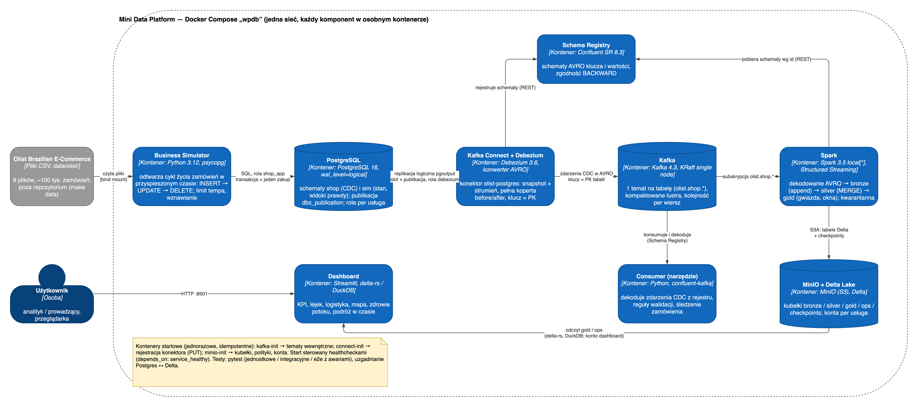

# Mini Data Platform: analityka e-commerce w czasie rzeczywistym

Projekt semestralny (WPDB). Platforma danych w kontenerach Docker, która odtwarza historię prawdziwego sklepu internetowego (zbiór Olist) i przetwarza zmiany w bazie na bieżąco: każda zmiana w PostgreSQL trafia przez CDC do Kafki, Spark buduje z niej warstwy bronze → silver → gold w formacie Delta w MinIO, a dashboard pokazuje wyniki na żywo.

```
Olist CSV ─► Business System ─► PostgreSQL ─► Debezium ─► Kafka + Schema Registry ─► Spark ─► MinIO (Delta) ─► Streamlit
```



**Status:** wszystkie etapy (0–5) zaimplementowane i przetestowane: testy jednostkowe, integracyjne i e2e z awariami (symulator, PostgreSQL, Debezium, Kafka, Spark, MinIO/Delta, dashboard). Szczegóły: [`docs/README.md`](docs/README.md).

## Szybki start

Wymagania: Docker z Compose v2 i ok. 10 GB RAM dla Dockera, `make`, `curl`, `unzip`; do testów `uv` i JDK 17. Pełna lista: [08-operations.md §12.1](docs/design/08-operations.md#121-wymagania).

```bash
git clone https://github.com/oszypczy/wpdb-data-platform && cd wpdb-data-platform
make data                     # pobiera CSV Olist do data/olist/
make up                       # .env z .env.example, buduje i uruchamia stos, czeka na healthy
make ps                       # wszystkie usługi healthy, kontenery *-init zakończone kodem 0
docker compose run --rm consumer --stats   # zdarzenia CDC na żywo (Ctrl-C)
make test-integration         # testy integracyjne na działającym stosie
make down                     # stop z zachowaniem danych (make reset: pełny reset)
```

Dashboard: http://127.0.0.1:8501, Spark UI: http://127.0.0.1:4040, konsola MinIO: http://127.0.0.1:9091 (wszystkie porty tylko na `127.0.0.1`).

## Dokumentacja

- [Wdrożenie krok po kroku](docs/design/08-operations.md#12-wdrożenie-krok-po-kroku): wymagania, uruchomienie, adresy, weryfikacja, consumer, testy, reset, rozwiązywanie problemów
- [Odczyt danych z MinIO](docs/design/06-minio-delta.md#9-odczyt-danych-wymagana-dokumentacja-i-odczyt-bez-sparka): katalog tabel Delta, DuckDB, delta-rs, Spark
- [`docs/README.md`](docs/README.md): indeks dokumentacji i status komponentów
- [`docs/architecture-explained.md`](docs/architecture-explained.md): architektura po kolei, element po elemencie
- [`docs/design/00-overview.md`](docs/design/00-overview.md): decyzje, przepływ danych i plan prac

## Dane

Olist Brazilian E-Commerce (CC BY-NC-SA 4.0). Dane nie są w repozytorium; pobiera je `make data` (bez konta Kaggle). Szczegóły: [`data/olist/README.md`](data/olist/README.md).
